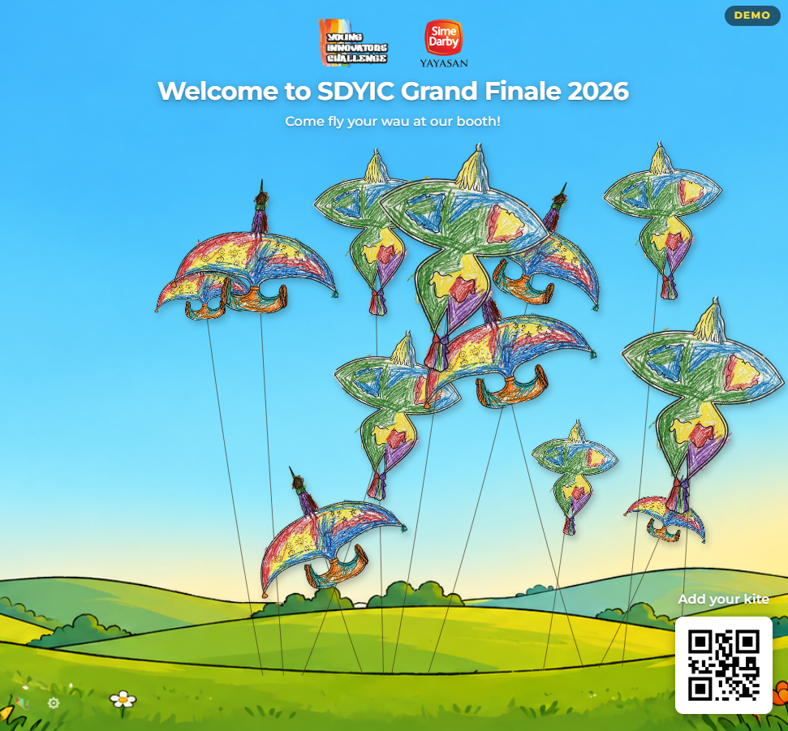

<div align="center">



# Sketch Kites

[](https://github.com/orgs/Chumbaka-Asia/repositories?q=topic%3Aplayground-commons)

Originally created for the STEM Carnival held during the Sime Darby Young Innovators Challenge (SDYIC) 2026.

[Overview](#overview) • [Features](#features) • [Getting Started](#getting-started) • [Exhibition Mode](#exhibition-mode) • [Display Settings](#display-settings) • [Export & Gallery](#export-import--gallery) • [How It Works](#how-it-works) • [Project Structure](#project-structure)

</div>

## Overview

Sketch Kites lets users colour traditional Malaysian kite (Wau) templates, upload photos of their drawings, and see them fly in a shared animated sky.

The application has three pages:

| Page | Purpose |
| --- | --- |
| [`upload.html`](upload.html) | Upload a photo of your coloured drawing, pick a kite template, align the photo with the template, name the kite and submit it |
| [`display.html`](display.html) | All submitted kites float in an animated sky. A header above the sky shows an editable title, subtitle and logos |
| [`gallery.html`](gallery.html) | Standalone viewer for exported kite JSON files |

There are two ways to run it:

- **Single computer** — Open the HTML files directly in a browser. Kites are saved in the browser (IndexedDB), and the upload and display tabs stay in sync through the BroadcastChannel API.
- **Exhibition** — Run the hub server (`scripts/server.py`). Any number of devices on the same Wi-Fi can submit kites to one shared display screen.

**Zero dependencies:** no build step, no `package.json`, no `npm install`. The app is plain HTML, CSS and JavaScript. The exhibition server uses the Python 3.7+ standard library only.

## Features

### Kites

- **Three traditional Wau templates** — Wau Bulan (Moon Kite), Wau Jala Budi (fishing net motifs) and Wau Kucing (cat-shaped)
- **Background removal** — The kite is cut out of the photo automatically. With a template, the template outline is used as a mask. Without one, the background is removed from the photo's corners.
- **Alignment editor** — Drag, rotate and zoom the photo to match the template outline before the kite is cut out
- **Animated sky** — Kites float with sine-wave motion and a curved string, and rise from the ground when launched
- **Kite names** — A kite's name (up to 40 characters) shows when you hover over it, and every few seconds on a random kite
- **Print template** — `colouring-templates/sketch-kites-2up-template.pdf` is a printable template sheet

### Display

- **Header** — Editable title and subtitle, plus up to three logos (`images/logo01.png` to `logo03.png`)
- **Backgrounds** — Vista (illustrated scene, default), Classic and Enhanced (paper-cut skies)
- **QR code** — A QR code in the corner that visitors can scan to open the upload page, or any other URL you choose
- **Settings panel** — Controls for speed, kite count, kite size, shadows, header, logos, background and QR code. See [Display Settings](#display-settings).
- **Demo mode** — A self-running showcase with sample kites. See [Demo mode](#demo-mode).

### Sync & Persistence

- **Single computer** — Kites are stored in the browser's IndexedDB and sent between tabs with BroadcastChannel
- **Exhibition** — Kites are stored in `kites-data.json` on the hub computer and sent to display screens with Server-Sent Events (SSE)
- **Export, import & gallery** — Export all kites as a JSON file, import them later, or browse them in `gallery.html`

## Getting Started

No installation or build step is needed. Open the files directly in any modern browser. For a multi-device setup, see [Exhibition Mode](#exhibition-mode).

### Quick start (single computer)

1. Open `display.html` in a browser tab.
2. Open `upload.html` in another tab of the same browser.
3. On the upload page: choose a photo, pick a template, align the photo, give the kite a name and click **Let it fly!**
4. Switch to the display tab. The kite launches from the ground.

> [!NOTE]
> The upload and display pages must be opened in the same browser to share kites in this mode. To share kites between devices, use [Exhibition Mode](#exhibition-mode).

### Quick start (exhibition)

Use this when visitors upload kites from their own devices to one big screen.

1. Connect the hub computer and all other devices to the same Wi-Fi. A travel router works best.
2. On the hub computer, double-click `start.bat`. A window opens and shows two addresses.
3. On the display screen, open the "Display screen" address in a browser. Press **F11** for full screen.
4. On each upload device, open the "Kite kiosk" address, or scan the QR code on the display screen.
5. Upload a kite. It flies on the display screen within a few seconds.

When you are done, close the server window. To start fresh next time, click ⚙ **Settings** → **Clear all kites** on the display screen.

For more detail, see [Exhibition Mode](#exhibition-mode).

### Demo mode

Add `?demo` to the display address to see the display with sample kites and no real data. For example `display.html?demo`, or `http://<host>:8080/display.html?demo` while the server is running.

- 12 sample kites (the images `test-kite-01.png` and `test-kite-02.png` in `images/`) fly on load, and a new one launches every 6 seconds. Use `?demo=30` to choose the starting number of kites. It cannot be higher than **Max kites**.
- It never reads or writes real kites. It does not connect to the hub, use BroadcastChannel, or touch IndexedDB or kite data in `localStorage`. Kites submitted from other pages do not appear in a demo tab.
- Import, Export and the reset and clear buttons are hidden. A **DEMO** badge is shown, and the settings panel says it is in demo mode.
- The QR code option **Upload page (auto)** shows no QR code in demo mode. Use **Custom URL** to test the QR code.

Use the **Speed** slider in the settings panel to see the slow size and height change quickly.

## Exhibition Mode

Run a local hub server so multiple upload devices (tablets, laptops, phones) can submit kites to a single shared display screen over Wi-Fi. No internet connection is needed.

### Requirements

- Python 3.7+ on the hub computer (standard library only, no `pip install`)
- All devices on the same Wi-Fi network

### Setup

**On the hub computer** (the one connected to the display screen):

1. Double-click `start.bat`, or run `python scripts/server.py` from the project folder. To use a different port, add it at the end: `python scripts/server.py 9000`. The default port is 8080.
2. The server prints the two addresses to use:

   ```text
   Display screen  ->  http://localhost:8080/display.html
   Kite kiosk      ->  http://192.168.1.5:8080/upload.html
   ```

3. Open the display address in a browser on the display screen.

**On each upload device** (any device on the same Wi-Fi):

1. Open the "Kite kiosk" address in a browser, or scan the QR code shown on the display screen.
2. Submit a kite. It appears on the display screen within a few seconds.

> [!TIP]
> Write the upload address on a card at each station so visitors can type it in easily.

### Network options

| Option | Setup | Notes |
| --- | --- | --- |
| Venue Wi-Fi | Connect all devices to the existing Wi-Fi | No setup, but depends on the venue's network |
| Travel router | Plug in a router and connect all devices to it | Self-contained, no internet needed. **Recommended** |
| Windows Mobile Hotspot | Turn on in Settings → Network → Mobile Hotspot | No extra hardware. One-time setup on the hub computer |

> [!NOTE]
> A travel router (for example the TP-Link TL-WR802N) creates a private Wi-Fi network that does not depend on the venue's internet.

### Connection status

When the display is served by the hub, the top of the settings panel shows a connection status. If the connection drops, the display retries automatically (waiting 3 s, then longer, up to 30 s). Click **Reconnect** to retry straight away.

### Between sessions

- To remove all kites, open the display screen, click ⚙ **Settings**, then **Clear all kites** (under **Cache**). This clears every connected screen and empties `kites-data.json`.
- If the hub computer restarts, kites load again from `kites-data.json`.

### Server API

| Method | Path | Purpose |
| --- | --- | --- |
| `GET` | `/api/kites` | Return all kites as a JSON array |
| `POST` | `/api/submit` | Add a kite, save it and send it to all display screens |
| `GET` | `/api/events` | SSE stream (`new-kite`, `remove-kite` and `clear` events) |
| `POST` | `/api/remove-kite` | Remove one kite by `id` |
| `POST` | `/api/clear` | Remove all kites |
| `GET` | `/api/host-info` | Return the server's local network IP and port (`{ip, port}`). The display uses this to build the QR code address. |
| `GET` | any other path | Serve files from the project folder |

The server sends a keep-alive ping every 30 seconds on each SSE connection and allows cross-origin requests (CORS) on the API.

## Display Settings

Click ⚙ in the corner of `display.html` to open the settings panel. The header text, logos, background and QR code settings are remembered by the browser. Speed, Max kites, Scale and Shadows go back to their defaults when the page is reloaded.

| Section | Control | What it does |
| --- | --- | --- |
| **Display** | Speed (1×–100×) | Speeds up the slow size and height change of the kites. Default is 10×. |
| | Max kites (50–500) | Maximum number of kites in the sky. Default is 200. When there are more, the oldest kites drift away. |
| | Scale (40%–140%) | Overall kite size. Default is 70%. |
| | Reset animation | Sets Speed back to 10×. |
| **Shadows** | Opacity, Distance | Strength and length of the kite shadows. |
| **Header text** | Title, Subtitle | Text shown above the sky (up to 80 characters each). |
| **Logos** | Logo 1–3 | Turn each logo on or off. Enabled logos are centred together. |
| **Background** | Scene | Vista, Classic or Enhanced. |
| **QR code** | Show QR code, URL | Show or hide the QR code and choose what it links to (see below). |
| **Cache** | Reset cache / Clear all kites | Removes all kites. See below. |

> [!WARNING]
> In exhibition mode, lowering **Max kites** below the current number of kites permanently removes the oldest kites from the hub for everyone. The panel asks you to confirm first.

### QR code

The QR code is generated in the browser. **URL** has two options:

- **Upload page (auto)** — Links to `upload.html` on the hub computer's network address. Only works when the display is served by the hub server.
- **Custom URL** — Links to any address you type. Works in every mode. If the box is empty, no QR code is shown.

### Clearing kites

- **Single computer:** the button is **Reset cache**. It removes the kites stored in this browser.
- **Exhibition:** the button is **Clear all kites**. It removes all kites from the hub and from every connected screen.

## Export, Import & Gallery

### Export

Click the 🪁 button on the display page to open the **Recent kites** panel. Click **Export** to download a JSON file (`sketch-kites-export-YYYY-MM-DD.json`) with all kites, including their images (as base64), names and motion settings.

You can also remove a single kite from this panel with the **×** button.

### Import

Click **Import** in the same panel and choose a previously exported JSON file. Entries without an image, or with an ID that already exists, are skipped. Imported kites appear in the sky straight away. They are saved in the browser (single computer) or on the hub server (exhibition).

### Gallery page

Open [`gallery.html`](gallery.html) in a browser, including directly from your files. Choose or drop an exported JSON file (or the server's `kites-data.json`) to see each drawing with its name, ID and launch date.

- Search by name or ID
- Sort by export order, newest first or oldest first
- Click **Download HTML gallery** to save a self-contained copy that opens with all kites already loaded. Keep the original JSON file if you want to import the kites back into the display.

The gallery reads the file in your browser only. It does not change the file or the live display. Records without a valid ID or image are skipped, and the page tells you how many were skipped.

## How It Works

### Image processing

On `upload.html`:

1. **Upload a photo** — Take a photo or choose an image file of the coloured kite.
2. **Pick a template** — Wau Bulan, Wau Jala Budi or Wau Kucing.
3. **Align** — Drag the photo, and use the Rotate and Zoom sliders, until it matches the template outline. Click **Apply**.
4. **Cut-out** — The template image is filled with "outside" from all four corners: every bright pixel (red, green and blue all 200 or higher) that can be reached from the edges is treated as outside the kite. The photo is then drawn with your alignment, and the outside pixels become transparent.
5. **Preview and name** — Check the result (use the toggle to compare with the original photo), type a name and click **Let it fly!**

If you do not pick a template, the alignment step is skipped. The background is removed by filling from the four corners of the photo instead (pixels with red, green and blue all 220 or higher).

The processed image is at most 800 px on its longest side.

### Kite motion

In `display.html`, each kite:

- Moves side to side and up and down in a slow sine-wave pattern
- Is held by a curved string from a point at the bottom of the screen
- Slowly changes size (between about 70% and 100%) and height. One half cycle takes `DECAY_TAU`, which is 30 minutes. The **Speed** setting shortens this.
- Launches by rising from the ground over 4 seconds and fading in. This only happens for kites that arrive while the display is open. Kites loaded when the page opens start in place.
- Drifts away and fades out over 3.5 seconds when it is removed because of the **Max kites** limit

### Sync mechanism

The pages check `window.location.protocol` to choose a mode:

| Mode | Address starts with | Live updates | Kite storage |
| --- | --- | --- | --- |
| **Single computer** | `file:` | `BroadcastChannel('sketch-kites')` | IndexedDB (`scripts/kite-store.js`) |
| **Exhibition** | `http:` or `https:` | SSE from `/api/events` | `kites-data.json` on the hub |

The header text, logos, background and QR code settings are saved in the browser's `localStorage` in both modes.

Older versions kept kites in `localStorage`. These are moved to IndexedDB automatically the next time the page runs in single-computer mode.

### Data flow

**Single computer** (files opened directly):

```text
[Upload page] -- BroadcastChannel --> [Display page]
      |                                    |
      +------------ IndexedDB <------------+
```

**Exhibition** (served by `scripts/server.py`):

```text
[Device 1] -+
[Device 2] -+-- POST /api/submit --> [server.py] -- SSE /api/events --> [Display screen]
[Device 3] -+                              |
                                     kites-data.json
```

### Kite object structure

Each kite in IndexedDB, on the server or in an export file has these fields:

| Field | Type | Description |
| --- | --- | --- |
| `id` | string | Unique ID (`Date.now()` plus a random suffix) |
| `dataURL` | string | PNG data URL of the cut-out kite |
| `name` | string | Name typed by the user (max 40 characters) |
| `cx`, `cy`, `maxCy` | number | Position as a fraction (0–1). `cy` is the highest point and `maxCy` the lowest point of the vertical movement. |
| `ampX`, `ampY`, `freqX`, `freqY` | number | Sine-wave size and speed |
| `phaseX`, `phaseY` | number | Sine-wave starting offsets (0 to 2π) |
| `rockAmp`, `rockFreq`, `rockPhase` | number | Side-to-side tilt of the kite |
| `scale` | number | Base size |
| `anchorX`, `anchorY` | number | Where the string is held |
| `createdAt` | number | Time created, in milliseconds since 1970 |

## Project Structure

```text
├── upload.html              Upload and image processing page
├── display.html             Animated sky display
├── gallery.html             Viewer for exported kite JSON files
├── start.bat                Double-click launcher for scripts/server.py
├── scripts/
│   ├── server.py            Hub server for exhibition mode
│   ├── kite-store.js        IndexedDB kite storage for single-computer mode
│   └── qr.js                QR code library (qrcode-generator, MIT)
├── colouring-templates/
│   ├── wau-bulan.png        Kite template images
│   ├── wau-jala-budi.png
│   ├── wau-kucing.png
│   └── sketch-kites-2up-template.pdf   Printable template sheet
├── images/
│   ├── logo01.png           Header logos (logo01 to logo03)
│   ├── logo02.png
│   ├── logo03.png
│   ├── sketch-kites-vista-clear-21-9.png   Vista background image
│   ├── test-kite-01.png     Sample kite images for demo mode
│   └── test-kite-02.png
└── kites-data.json          Hub server storage (created automatically)
```

## Acknowledgements

Traditional Wau kite designs are part of Malaysia's cultural heritage. The templates in this project are adapted for educational colouring activities.
